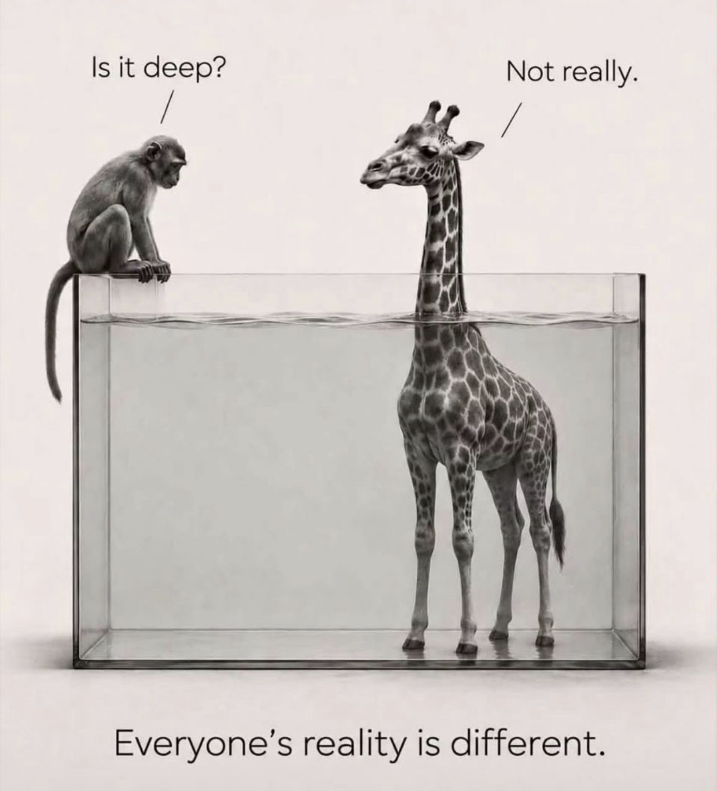

Image: creator unknown. I came across it on LinkedIn a while back and haven't been able to trace who made it. If it's yours, <a href="https://www.linkedin.com/in/subomidotcom/">message me</a> and I'll credit you properly.

I saved this image a while ago and I keep coming back to it. A monkey sits on the edge of a tank and asks, "Is it deep?" The giraffe standing in the same water answers, "Not really."

Both of them are telling the truth.

For the monkey, that tank is a real risk. For the giraffe, it's a paddle. Same tank, same water, two completely different answers. Neither of them is wrong. They're just standing at different heights.

## The obvious thing I keep relearning

If I had to name my one biggest realisation in recent times, it would be this: everyone has a different lens through which they see the world.

I know. It sounds trivial. It's the kind of line you'd find printed on a mug. But knowing something and actually feeling it are two different things, and lately I've been feeling it a lot.

It has been a real eye opener. It has taught me to try harder to see the world through other people's lenses before I decide what's true, what's obvious, or what "everyone" knows.

## Questions are how I borrow someone's lens

The way I do this is simple. I ask questions. Sometimes too many questions.

How did you get into that? Why do you do it that way? What does a normal day look like for you? What do you use for that?

People who know me will tell you I rarely stop at one. But every answer shows me a piece of a world I wasn't standing in. Honestly, it's one of the most fascinating parts of being around people. You start to see how many ways there are to live a perfectly good life that look nothing like yours.

## People survive without Claude. Who knew?

Recently my sister-in-law came to visit, and somewhere in a conversation I found out she had never used Claude. Not once.

I was genuinely astonished. Claude is open on my screen most of the day. I use it to write, to plan, to build and to think things through. It's so woven into how I work that I had quietly assumed it was part of everyone's day too.

It isn't. Claude exists in my bubble. Outside that bubble there's a whole cosmos of people who only know Claude as a French name, or as the middle of Jean-Claude Van Damme. And they're doing just fine.

That was me being the monkey, peering into the tank and assuming everyone else was in the same water I was.

## Your normal is not the default

The tools you live in, the words you use every day, the problems that feel urgent to you: to someone else they might be invisible. That doesn't make them wrong, and it doesn't make you wrong. It just means you're standing at a different height.

I see this all the time in my work. A founder is usually the giraffe. They're so deep in their product that everything about it feels obvious. Their customer is the monkey on the edge of the tank, still trying to work out whether it's safe to get in. Good communication starts when you stop answering from your own height and climb up next to the person asking.

## What I'm practising

- **Assume less.** What feels obvious to me is usually just my height in the water.
- **Ask more.** A question is the cheapest way to borrow someone else's view.
- **Notice the surprise.** The moment something astonishes me is usually the moment my bubble just got a little bigger.

---

What's something you were sure everyone knew, until you found out they didn't?
